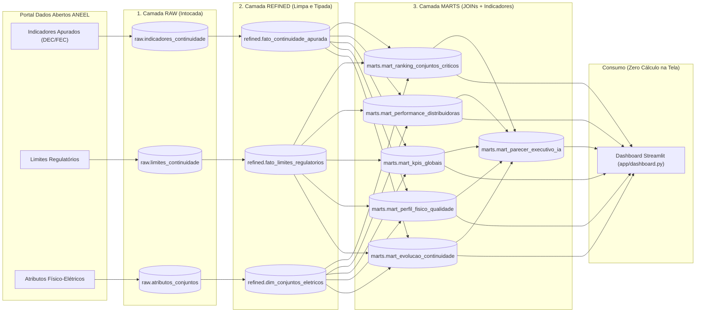

# ⚡ Pipeline de Qualidade da Distribuição de Energia Elétrica (ANEEL — DEC & FEC)

> **O Desafio Final: O Seu Pipeline, do Zero**  
> Engenharia de Dados ponta a ponta com **Python, SQL (DuckDB), IA (`google-genai`), Testes Unitários (`pytest`), Git e Streamlit**.

---

## 📋 Resumo Executivo dos Indicadores (Ciclo 2024 — Camada `marts`)

| Dimensão Analisada | Destaque Principal | Indicador Apurado | Referência / Meta ANEEL |
| :--- | :--- | :--- | :--- |
| **Maior Pressão Regulatória** | **ENEL SP (SP)** | DEC: **13,08 h** (Severidade: **1,75x**) | Limite: **7,48 h** |
| **Benchmark de Confiabilidade** | **CELESC-DIS (SC)** | Severidade: **0,92x** | Limite: **7,39 h** |
| **Conjunto Mais Crítico (#1)** | **Interlagos (ENEL SP)** | **1.125.378** UC-h excedentes | DEC: 13,27 h vs. 7,20 h |
| **Perfil Físico Mais Exposto** | **Rural / Rede Extensa** | Transgressão: **100,0%** | DEC Médio: 25,63 h |

---

## 1. Contexto e Fonte de Dados

Este projeto constrói um pipeline analítico completo sobre dados públicos oficiais do **Portal de Dados Abertos da ANEEL** (*Agência Nacional de Energia Elétrica* — Licença Aberta Governamental / Dados Abertos), avaliando a **Continuidade do Serviço de Distribuição de Energia Elétrica** no Brasil por meio dos indicadores coletivos **DEC** e **FEC** (PRODIST Módulo 8):

* **DEC (*Duração Equivalente de Interrupção por Unidade Consumidora*):** Tempo médio (em horas) em que uma unidade consumidora ficou sem energia elétrica no período apurado.
* **FEC (*Frequência Equivalente de Interrupção por Unidade Consumidora*):** Número médio de interrupções sofridas por unidade consumidora no período apurado.

### Tabelas Relacionadas na Origem (3 Tabelas com `JOIN`)

O pipeline extrai e integra **3 tabelas oficiais** conectadas pelas chaves `IdeConjUndConsumidoras` (Identificador do Conjunto Elétrico), `SigAgente` (Distribuidora) e `AnoIndice` (Ano de Apuração):

| Tabela no Schema `raw` | Chave(s) de Ligação | Descrição |
| :--- | :--- | :--- |
| `raw.indicadores_continuidade` | `IdeConjUndConsumidoras`, `AnoIndice`, `SigAgente` | Valores apurados (`VlrIndiceEnviado`) de DEC e FEC enviados pelas distribuidoras (mensal e anual). |
| `raw.limites_continuidade` | `IdeConjUndConsumidoras`, `AnoLimite` | Limites regulatórios máximos (`VlrLimiteEnviado`) homologados pela ANEEL para cada conjunto e ano. |
| `raw.atributos_conjuntos` | `IdeConjUndConsumidoras`, `AnoIndice` | Atributos físico-elétricos de cada conjunto: unidades consumidoras (`QtdUCAtendidas`), área (`km²`), extensão de rede (`km`) e subestações. |

---

## 2. As Perguntas de Negócio e o que os Indicadores Respondem

### 📌 Pergunta 1 — Conformidade Regulatória das Distribuidoras
> *Quais concessionárias possuem o maior percentual de conjuntos elétricos violando os limites anuais de DEC e FEC definidos pela ANEEL, e qual o Índice de Severidade Regulatória (`DEC Apurado / DEC Limite`)?*

* **Indicador na camada `marts`:** `marts.mart_performance_distribuidoras`
* **Achado Analítico (Ciclo 2024):**
  * **ENEL SP (SP)** apresentou o maior Índice de Severidade Regulatória de DEC (**1,75x** o limite ANEEL, com DEC apurado ponderado de **13,08 h** contra meta de **7,48 h** e **100%** dos conjuntos avaliados em transgressão).
  * **EQUATORIAL GO (GO)** operou com severidade de **1,49x** (DEC ponderado de **18,39 h** vs. limite de **12,31 h**).
  * Concessionárias como **COPEL-DIS (PR)** (**0,98x**), **CPFL PAULISTA (SP)** (**0,94x**) e **CELESC-DIS (SC)** (**0,92x**) mantiveram o DEC global ponderado abaixo do teto regulatório.

### 🚨 Pergunta 2 — Impacto Real ao Consumidor (Consumidor × Horas sem Energia)
> *Quais conjuntos elétricos concentram o maior volume absoluto de horas-consumidor perdidas acima da meta regulatória (`(DEC Apurado - DEC Limite) × UCs Atendidas`)?*

* **Indicador na camada `marts`:** `marts.mart_ranking_conjuntos_criticos` (`uc_horas_excedentes` e `ranking_criticidade_ano`)
* **Achado Analítico (Ciclo 2024):**
  1. **#1 Interlagos (ENEL SP):** **1.125.378 consumidor-horas excedentes** (DEC apurado de 13,27 h vs. limite de 7,20 h em 185.400 UCs).
  2. **#2 Baixada Nova Iguaçu (LIGHT - RJ):** **1.078.000 consumidor-horas excedentes** (DEC apurado de 15,80 h vs. limite de 10,20 h em 192.500 UCs).
  3. **#3 Itapecerica da Serra (ENEL SP):** **985.332 consumidor-horas excedentes** (DEC apurado de 21,96 h vs. limite de 11,50 h).

### 🌐 Pergunta 3 — Perfil Físico-Elétrico × Confiabilidade da Rede
> *Como a densidade de consumidores (`UCs por km²`) e a extensão da rede se relacionam com o estouro de DEC (tempo de reparo/deslocamento) vs. FEC (frequência de falhas)?*

* **Indicador na camada `marts`:** `marts.mart_perfil_fisico_qualidade`
* **Achado Analítico:**
  * Conjuntos de perfil **Rural / Rede Extensa** (extensão média > 3.800 km de rede) apresentam o maior DEC absoluto (**25,63 h** vs. limite de **18,17 h**, desvio médio de **+7,47 h**), reflexo direto das longas distâncias de patrulhamento e recomposição.
  * Já nos conjuntos **Urbano / Metropolitano** e **Urbano Alta Densidade**, embora o DEC absoluto seja menor, cada hora de estouro multiplica-se por mais de 150 mil UCs por conjunto, gerando o maior risco financeiro de compensações regulatórias (DIC/FIC).

### 📈 Pergunta 4 — Trajetória e Sazonalidade Operacional
> *Como evolui a continuidade do fornecimento ao longo dos meses (período chuvoso/verão vs. período seco) e entre os anos de 2022 a 2024?*

* **Indicador na camada `marts`:** `marts.mart_evolucao_continuidade`
* **Achado Analítico:**
  * Os meses do **Período Chuvoso / Verão** (Janeiro a Março e Novembro a Dezembro) concentram **54,5%** de toda a duração anual de interrupções (DEC), exigindo reforço preventivo de poda e equipes de prontidão antes de novembro.

---

## 3. Arquitetura em 3 Camadas (`raw`, `refined`, `marts`)



---

## 4. Estrutura do Projeto

```text
.
├── app/
│   └── dashboard.py                    # Painel Streamlit (Seção 07) lendo apenas de marts.*
├── sql/
│   ├── refined/                        # Limpeza, deduplicação, tipagem e pivotagem
│   │   ├── dim_conjuntos_eletricos.sql
│   │   ├── fato_continuidade_apurada.sql
│   │   └── fato_limites_regulatorios.sql
│   └── marts/                          # JOINs entre as 3 tabelas e cálculo de indicadores
│       ├── mart_evolucao_continuidade.sql
│       ├── mart_kpis_globais.sql
│       ├── mart_performance_distribuidoras.sql
│       ├── mart_perfil_fisico_qualidade.sql
│       └── mart_ranking_conjuntos_criticos.sql
├── src/
│   ├── __init__.py
│   ├── extract_raw.py                  # Extração da origem ANEEL -> schema raw (intocado)
│   ├── transform_refined.py            # Execução da camada raw -> refined
│   ├── build_marts.py                  # Execução da camada refined -> marts
│   ├── ai_insights.py                  # Parecer executivo com IA (Gemini API) sobre os marts
│   └── run_pipeline.py                 # Orquestrador completo do pipeline
├── tests/
│   └── test_pipeline.py                # Testes unitários pytest em memória (:memory:) com dados inventados
├── pytest.ini
├── requirements.txt
└── README.md
```

---

## 5. Como Executar o Projeto

### 1. Instalar dependências
```powershell
python -m venv .venv
.\.venv\Scripts\pip install -r requirements.txt
```

### 2. Executar o pipeline completo (`raw` -> `refined` -> `marts` -> `IA`)
```powershell
.\.venv\Scripts\python.exe -m src.run_pipeline
```
*(Opcional: defina `GEMINI_API_KEY` no arquivo `.env` para gerar o parecer via `gemini-3.8-flash` na Interactions API).*

### 3. Rodar os testes unitários isolados (`pytest` em memória, sem tocar no banco do projeto)
```powershell
.\.venv\Scripts\python.exe -m pytest -v
```

### 4. Abrir o Dashboard (Seção 07 — lê exclusivamente da camada `marts`)
```powershell
.\.venv\Scripts\python.exe -m streamlit run app/dashboard.py --server.port 8502
```
